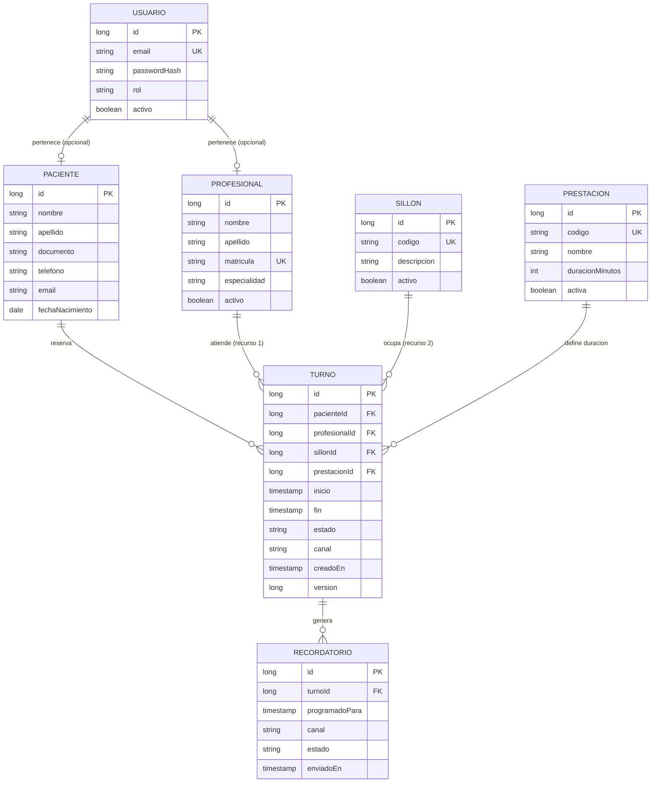

# Modelo de Datos

## Dominios

| Dominio | Descripción |
|---|---|
| Agenda | Turno, disponibilidad y recursos (profesional + sillón) |
| Catálogo | Prestaciones (con duración) y sillones/boxes |
| Personas y accesos | Paciente, Profesional (Odontólogo), Usuario y roles |
| Notificaciones | Recordatorio (WhatsApp) asociado a un turno |

## ERD

> Los tipos de atributos se expresan en Python; los nombres conceptuales del dominio y del contrato API se conservan. La política de zona horaria está pendiente en `10_preguntas_abiertas.md`.

## Entidades

### Usuario

- **Atributos:**
  - `id: int` — PK.
  - `email: str` — único, identificador de login.
  - `passwordHash: str` — hash (bcrypt/argon2), nunca texto plano.
  - `rol: str` (enum) — `PACIENTE | ODONTOLOGO | RECEPCIONISTA | ADMINISTRADOR`.
  - `activo: bool` — habilitación de la cuenta.
- **Relaciones:** `0..1 : 1` con `Profesional` y `0..1 : 1` con `Paciente` (un usuario puede representar a un profesional o a un paciente; los roles de staff no necesitan perfil clínico).
- **Constraints:** `email` único; `rol` no nulo.
- **Índices:** índice único sobre `email`.

### Paciente

- **Atributos:**
  - `id: int` — PK.
  - `nombre: str`, `apellido: str`.
  - `documento: str` — documento de identidad (dato personal, protegido por RN-LG).
  - `telefono: str` — usado por los recordatorios de WhatsApp.
  - `email: str`.
  - `fechaNacimiento: date` — opcional.
- **Relaciones:** `1 : N` con `Turno`.
- **Constraints:** `telefono` y `email` con formato validado; `documento` único por consultorio (mono-tenant).
- **Índices:** índice sobre `telefono` (búsqueda para recordatorios/webhooks).

### Profesional (Odontólogo)

- **Atributos:**
  - `id: int` — PK.
  - `nombre: str`, `apellido: str`.
  - `matricula: str` — única (identifica al odontólogo).
  - `especialidad: str` — general o especialidad.
  - `activo: bool` — un profesional inactivo no puede recibir turnos nuevos.
- **Relaciones:** `1 : N` con `Turno` (como **recurso 1**).
- **Constraints:** `matricula` única.
- **Índices:** índice sobre `activo` (filtro de disponibilidad).

### Sillon (box)

- **Atributos:**
  - `id: int` — PK.
  - `codigo: str` — único (ej. `BOX-1`).
  - `descripcion: str` — opcional.
  - `activo: bool` — un sillón inactivo no puede recibir turnos nuevos.
- **Relaciones:** `1 : N` con `Turno` (como **recurso 2**).
- **Constraints:** `codigo` único.
- **Índices:** índice sobre `activo`.

### Prestacion

- **Atributos:**
  - `id: int` — PK.
  - `codigo: str` — único (ej. `LIMPIEZA`, `ENDO`).
  - `nombre: str`.
  - `duracionMinutos: int` — **duración del turno derivada de la prestación** (RN-02).
  - `activa: bool`.
- **Relaciones:** `1 : N` con `Turno`.
- **Constraints:** `duracionMinutos > 0`; `codigo` único.
- **Índices:** índice único sobre `codigo`.

### Turno

- **Atributos:**
  - `id: int` — PK.
  - `pacienteId: int` — FK a `Paciente`.
  - `profesionalId: int` — FK a `Profesional` (**recurso 1**, obligatorio).
  - `sillonId: int` — FK a `Sillon` (**recurso 2**, obligatorio).
  - `prestacionId: int` — FK a `Prestacion` (de la que se deriva la duración).
  - `inicio: datetime` — inicio del intervalo.
  - `fin: datetime` — calculado como `inicio + duracionMinutos` (RN-02).
  - `estado: str` (enum) — `PENDIENTE | CONFIRMADO | CANCELADO | REALIZADO | AUSENTE`.
  - `canal: str` (enum) — `ONLINE | MOSTRADOR` (origen de la reserva, para trazabilidad).
  - `creadoEn: datetime` — auditoría.
  - `version: int` — **locking optimista** (columna de versión en el adaptador SQLAlchemy (`version_id_col`)).
- **Relaciones:** `N : 1` con `Paciente`, `Profesional`, `Sillon`, `Prestacion`; `1 : N` con `Recordatorio`.
- **Constraints:**
  - `inicio < fin` (intervalo semiabierto `[inicio, fin)`).
  - `fin = inicio + prestacion.duracionMinutos` (derivado, no editable).
  - **Constraint de exclusión (PostgreSQL):** `EXCLUDE USING gist (profesionalId WITH =, tsrange(inicio, fin, '[)') WITH &&)` y análogo para `sillonId` (RN-01/RN-03, refuerzo a nivel DB).
  - Sólo turnos en estado `PENDIENTE` o `CONFIRMADO` ocupan recursos.
- **Índices:** índices sobre `(profesionalId, inicio, fin)` y `(sillonId, inicio, fin)`; índice sobre `(pacienteId, inicio)`.

### Recordatorio

- **Atributos:**
  - `id: int` — PK.
  - `turnoId: int` — FK a `Turno`.
  - `programadoPara: datetime` — momento de envío (inicio − anticipación configurada).
  - `canal: str` (enum) — `WHATSAPP` (único en el MVP).
  - `estado: str` (enum) — `PROGRAMADO | ENVIADO | FALLIDO | CANCELADO`.
  - `enviadoEn: datetime` — opcional, se completa al enviar.
- **Relaciones:** `N : 1` con `Turno`.
- **Constraints:** `programadoPara < turno.inicio`; un turno activo tiene a lo sumo un recordatorio vigente.
- **Índices:** índice sobre `(estado, programadoPara)` (consulta del scheduler).

## Relaciones y cardinalidades (resumen)

| Relación | Cardinalidad | Regla |
|---|---|---|
| Paciente — Turno | 1 : N | Un paciente tiene muchos turnos |
| Profesional — Turno | 1 : N | Un turno referencia exactamente un profesional (recurso 1) |
| Sillon — Turno | 1 : N | Un turno referencia exactamente un sillón (recurso 2) |
| Prestacion — Turno | 1 : N | La duración del turno se deriva de la prestación |
| Turno — Recordatorio | 1 : N | A lo sumo un recordatorio vigente por turno |
| Usuario — Paciente/Profesional | 1 : 0..1 | Perfil opcional según rol |

## Invariantes del modelo

1. Todo `Turno` persistido tiene `profesionalId` **y** `sillonId` no nulos (recurso doble, RN-01).
2. `Turno.fin` nunca es un valor ingresado a mano: siempre se deriva de `Prestacion.duracionMinutos` (RN-02).
3. Para un mismo `profesionalId`, los intervalos `[inicio, fin)` de turnos activos no se intersectan; se permite `fin == inicio` exacto (RN-03).
4. Ídem para un mismo `sillonId` (RN-03).
5. Un turno `CANCELADO` no ocupa ni al profesional ni al sillón (RN-04).
6. `Recordatorio.programadoPara` es anterior a `Turno.inicio` (RN-05).
7. No se almacenan datos clínicos sensibles; los datos personales se limitan a lo necesario para agendar y notificar (RN-LG, Ley 25.326).

## Seed data inicial (SINTÉTICA — ver RN-LG)

> **IMPORTANTE:** los datos de ejemplo son **ficticios y sintéticos**. Está prohibido usar datos de pacientes reales en seeds, repositorios, fixtures o entornos de prueba (Ley 25.326 — RN-LG). Nombres, teléfonos y documentos son inventados.

**Sillones**

| codigo | descripcion | activo |
|---|---|---|
| BOX-1 | Sillón 1 — general | true |
| BOX-2 | Sillón 2 — general | true |

**Prestaciones** (la duración es el eje — RN-02)

| codigo | nombre | duracionMinutos |
|---|---|---|
| LIMPIEZA | Limpieza dental | 30 |
| CONSULTA | Consulta general | 20 |
| ENDO | Endodoncia | 60 |
| EXTRACCION | Extracción simple | 40 |

**Profesionales**

| nombre | apellido | matricula | especialidad | activo |
|---|---|---|---|---|
| Ana | Gómez | MP-00001 | Odontología general | true |
| Bruno | Díaz | MP-00002 | Endodoncia | true |

**Pacientes** (datos ficticios)

| nombre | apellido | documento | telefono | email |
|---|---|---|---|---|
| Carla | Pérez | 00000001 | +5490000000001 | paciente1@example.test |
| Diego | Ruiz | 00000002 | +5490000000002 | paciente2@example.test |

**Turnos de ejemplo** (recurso doble asignado)

| paciente | profesional | sillón | prestación | inicio | fin | estado | canal |
|---|---|---|---|---|---|---|---|
| Carla Pérez | Ana Gómez | BOX-1 | LIMPIEZA (30) | 2026-11-02T09:00 | 2026-11-02T09:30 | CONFIRMADO | ONLINE |
| Diego Ruiz | Bruno Díaz | BOX-2 | ENDO (60) | 2026-11-02T09:30 | 2026-11-02T10:30 | PENDIENTE | MOSTRADOR |

El segundo turno ilustra el encadenado exacto permitido por RN-03 sobre `BOX`/profesional distintos y deja evidencia del cálculo de duración.

## Referencias

- Reglas de negocio: [`05_reglas_de_negocio.md`](05_reglas_de_negocio.md)
- Concurrencia y constraint de exclusión: [`08_arquitectura_propuesta.md`](08_arquitectura_propuesta.md)
