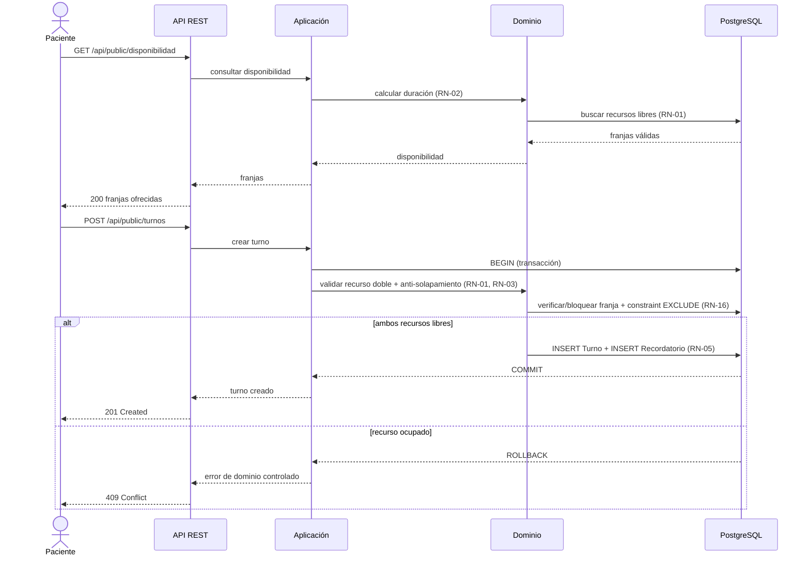

# Flujos Principales

Cada flujo se documenta extremo a extremo (pasos numerados + diagrama cuando aporta claridad).

---

## Flujo 1: Autenticación (login)

**Disparador**: un integrante del consultorio envía credenciales a `POST /api/auth/login`.
**Actor**: odontólogo / recepcionista / administrador.

**Pasos**:
1. El cliente envía `email` y `password`.
2. La API valida el formato de entrada (RN global de validación).
3. La aplicación busca el `Usuario` por email y verifica el hash de la contraseña.
4. Se verifica que la cuenta esté `activa`.
5. La aplicación emite un **JWT** con `sub` (userId) y `rol` embebido.
6. La API devuelve `200` con el token; en caso contrario `401` (sin revelar el campo fallido).
7. En cada request posterior, el filtro de seguridad valida el token y carga el rol para la autorización RBAC.

**Casos de error**:
- Credenciales inválidas → `401`.
- Cuenta inactiva → `403`.
- Token vencido en request posterior → `401`; el cliente usa `/api/auth/refresh`.

---

## Flujo 2: Reserva de turno por paciente (online)

**Disparador**: el paciente consulta disponibilidad y reserva.
**Actor**: paciente (cliente externo, posiblemente sin cuenta — reserva de invitado).

**Pasos**:
1. El paciente consulta `GET /api/public/disponibilidad?prestacionId=&fecha=`.
2. La aplicación calcula la duración desde la prestación (RN-02) y busca franjas donde exista **profesional libre Y sillón libre** (RN-01).
3. Devuelve las franjas ofrecidas (recurso doble ya resuelto).
4. El paciente elige una franja y envía `POST /api/public/turnos` con paciente, profesional, sillón y prestación.
5. La aplicación **revalida la disponibilidad en el momento de confirmar** (no confía en el paso 2) y abre una **transacción**.
6. Bloquea/verifica los dos recursos en la franja (locking) — si PostgreSQL, el constraint de exclusión `EXCLUDE USING gist` es la última barrera (RN-16).
7. Crea el `Turno` con `inicio`, `fin = inicio + duracionMinutos`, estado `PENDIENTE`/`CONFIRMADO`, canal `ONLINE` (RN-13).
8. Programa el `Recordatorio` a `inicio − anticipacion` (RN-05).
9. Commitea y devuelve `201` con el turno creado.

**Diagrama de secuencia**:

**Casos de error**:
- Franja ocupada al confirmar (perdió la carrera) → `409 Conflict`, se ofrece reintentar con otra franja.
- Prestación inactiva → `422`.
- Intervalo inválido (`inicio >= fin`) → `422` (RN-13).

---

## Flujo 3: Agendamiento por recepcionista en mostrador

**Disparador**: llega un paciente al mostrador.
**Actor**: recepcionista (autenticada).

**Pasos**:
1. La recepcionista busca/crea al `Paciente` (`GET/POST /api/pacientes`).
2. Consulta disponibilidad con el mismo endpoint de disponibilidad (misma fuente que el canal online — RN-09).
3. Selecciona prestación, profesional y sillón y envía `POST /api/turnos` (canal `MOSTRADOR`).
4. La aplicación ejecuta la misma validación transaccional del Flujo 2 (RN-01/RN-03/RN-16).
5. Se crea el turno y su recordatorio; la agenda del profesional y la del sillón quedan actualizadas de inmediato.

**Casos de error**:
- Franja ocupada → `409`; la recepcionista ofrece la franja más cercana.
- Paciente no registrado y sin datos mínimos → `422`.

**Nota**: la única diferencia con el Flujo 2 es el rol/canal; la disponibilidad y las garantías son idénticas.

---

## Flujo 4: Cancelación con liberación de cupo

**Disparador**: el paciente o la recepcionista cancela un turno.
**Actor**: paciente (propio) o recepcionista.

**Pasos**:
1. `POST /api/turnos/{id}/cancelar`.
2. La aplicación verifica propiedad (paciente) o rol (recepcionista) — RBAC.
3. Valida que la transición sea permitida (RN-08): sólo desde `PENDIENTE`/`CONFIRMADO`.
4. Cambia el estado a `CANCELADO` (RN-07).
5. Como el turno cancelado **no ocupa recursos** (RN-09), los dos recursos quedan libres de inmediato (RN-04).
6. Cancela el `Recordatorio` asociado (RN-05).
7. Devuelve `200`; el cupo ya aparece disponible en la próxima consulta de disponibilidad.

**Casos de error**:
- Cancelar un turno ya `CANCELADO`/`REALIZADO` → `409` (estado final, RN-08).
- Paciente intenta cancelar un turno ajeno → `403`.

---

## Flujo 5: Recordatorio automático por WhatsApp

**Disparador**: el scheduler evalúa recordatorios vencidos, o el alta/reprogramación de un turno.
**Actor**: sistema (job programado) + paciente (responde).

**Pasos**:
1. Al crear/reprogramar un turno se calcula `programadoPara = inicio − anticipacion` (RN-05/RN-12).
2. El scheduler consulta recordatorios con `estado = PROGRAMADO` y `programadoPara <= now`.
3. Por cada uno, la infraestructura envía el mensaje vía WhatsApp Business API.
4. Según la respuesta del proveedor, el recordatorio pasa a `ENVIADO` o `FALLIDO`.
5. Si el paciente responde confirmando, el webhook `POST /api/webhooks/whatsapp` actualiza el turno a `CONFIRMADO` (RN-08; una confirmación sobre turno cancelado no lo reactiva).
6. Si el turno se cancela antes del envío, el recordatorio pasa a `CANCELADO` (RN-05).

**Casos de error**:
- Falla del proveedor → recordatorio `FALLIDO`; se registra para reintento/observabilidad (ver pregunta abierta sobre reintentos).
- Respuesta tardía tras la franja → se ignora el cambio de estado.

---

## Referencias

- Reglas: [`05_reglas_de_negocio.md`](05_reglas_de_negocio.md)
- Concurrencia y constraint de exclusión: [`08_arquitectura_propuesta.md`](08_arquitectura_propuesta.md)
